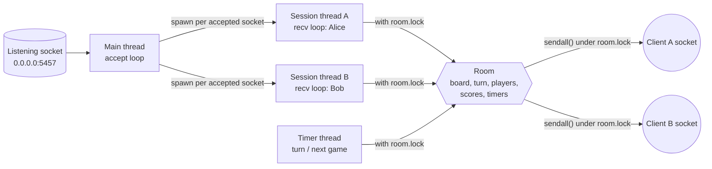
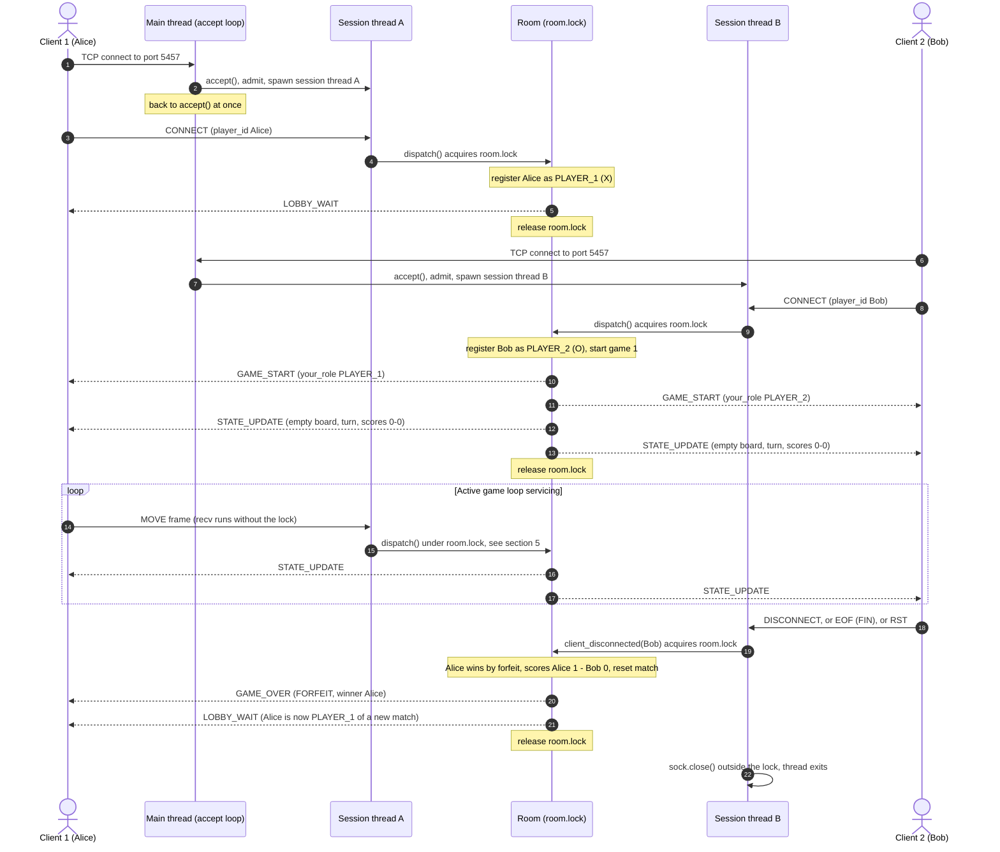
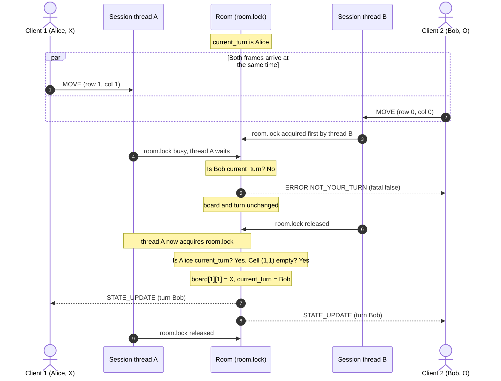
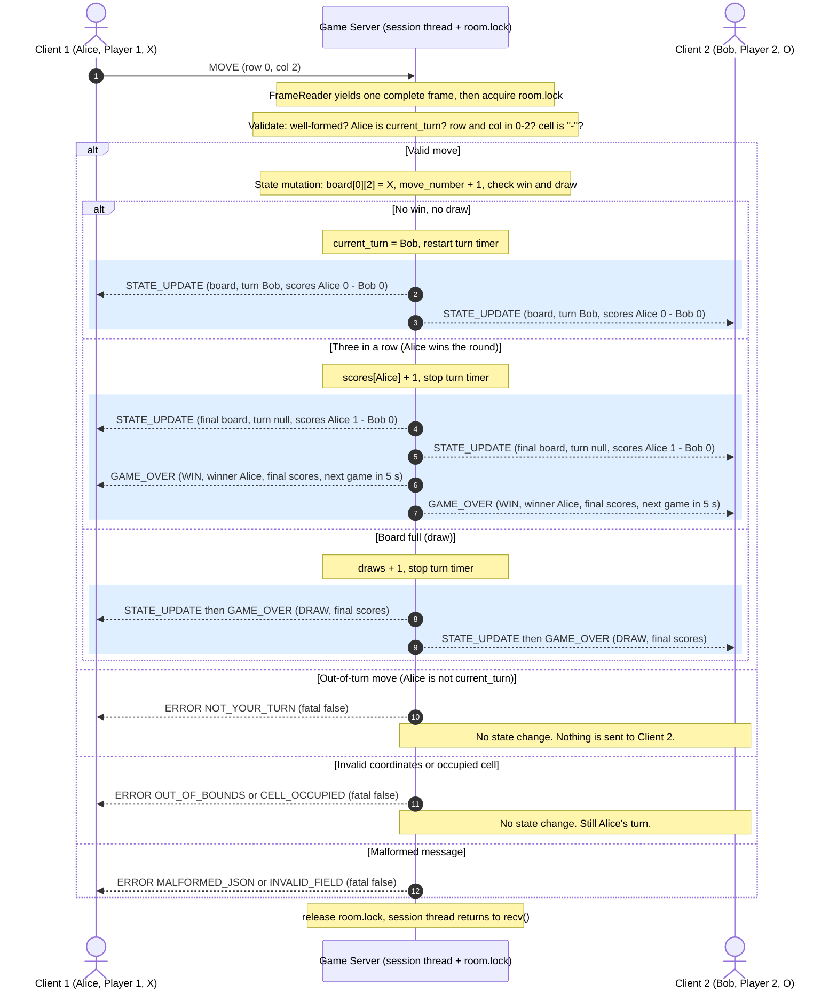
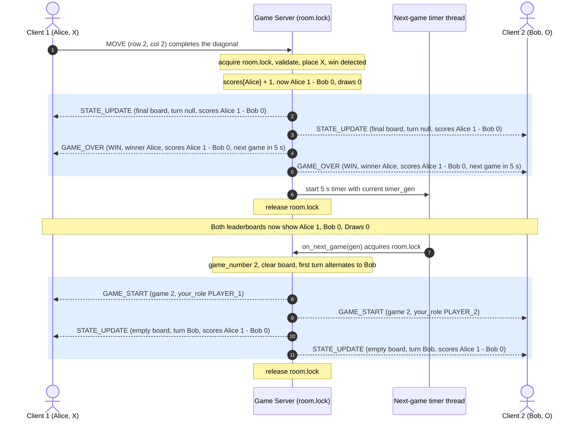

# Server Concurrency Architecture & Game Behavior Design

| | |
|---|---|
| **Project** | CS 457 Networked Tic-Tac-Toe |
| **Author** | Evan Lira |
| **Sprint** | 2: Game Behavior & Server Concurrency Architecture |
| **Version** | 1.0 (implements protocol version 1.2) |
| **Last updated** | 2026-10-18 |
| **Concurrency model** | **Option A: multi-threading.** One worker thread per client socket, plus one `threading.Lock` guarding all shared game state. |
| **Companion documents** | [`protocol_blueprint.md`](protocol_blueprint.md) · [`fsm_specification.md`](fsm_specification.md) · [`ai_prompts.md`](ai_prompts.md) |

This document specifies how the server handles several client connections at the same time without blocking, how shared game state is kept consistent across threads, and how moves, turn switches, and scores are broadcast to both clients. The wire protocol and the state machine from Sprint 1 are unchanged. References written as **B§n** point to [`protocol_blueprint.md`](protocol_blueprint.md), and **F§n** / **T*n*** to [`fsm_specification.md`](fsm_specification.md).

---

## Contents

1. [Overview](#1-overview)
2. [Concurrency Model Selection](#2-concurrency-model-selection)
3. [Thread Architecture & Connection Lifecycle](#3-thread-architecture--connection-lifecycle)
4. [Thread Safety & Lock Acquisition Strategy](#4-thread-safety--lock-acquisition-strategy)
5. [Client State & Turn Synchronization](#5-client-state--turn-synchronization)
6. [Score & Leaderboard Synchronization](#6-score--leaderboard-synchronization)
7. [Synchronous Broadcast Mechanism](#7-synchronous-broadcast-mechanism)
8. [Revision History](#8-revision-history)

### Sprint 2 Requirements Traceability

| Requirement | Where it is met |
|---|---|
| **Rubric 1** Concurrency model and the complete connection lifecycle: accept → registration → active game loop servicing → teardown | [§2](#2-concurrency-model-selection), [§3](#3-thread-architecture--connection-lifecycle) |
| **Rubric 2** Shared resources, race-condition prevention, exact `threading.Lock` acquire/release patterns | [§4](#4-thread-safety--lock-acquisition-strategy) |
| **Rubric 3** Mermaid `sequenceDiagram` embedded in this file | [§3.4](#34-connection-lifecycle-sequence-diagram), [§4.7](#47-race-condition-sequence-diagram), [§5.1](#51-move-round-trip-sequence-diagram), [§6.3](#63-round-completion--score-broadcast-sequence-diagram) |
| **Rubric 4** Move request → turn and legality validation → state mutation → broadcast `STATE_UPDATE` to all clients → score sync, with `alt`/`else` for invalid and out-of-turn moves | [§5](#5-client-state--turn-synchronization), [§6](#6-score--leaderboard-synchronization), [§7](#7-synchronous-broadcast-mechanism) |
| At least 2 simultaneous clients without blocking the server main loop | [§2.3](#23-why-the-server-never-blocks), [§2.4](#24-multi-client-capacity-planning) |
| Turn enforcement prevents out-of-turn moves from corrupting game state | [§5.3](#53-turn-enforcement), [§4.6](#46-race-conditions-and-how-they-are-prevented) |
| Broadcast guarantees both clients receive state updates synchronously | [§7](#7-synchronous-broadcast-mechanism) |

---

## 1. Overview

- **One server process, one game room, two player slots** (B§1). Clients connect over TCP to `server.lira.edu:5457`.
- **Server-authoritative.** The board, the turn, and the scores exist only in server memory. Clients send intents (`CONNECT`, `MOVE`, `DISCONNECT`) and draw whatever the server broadcasts.
- **Goal of this design:** serve both players, and any extra connection attempts, at the same time. No single slow, silent, or disconnected client may block the accept loop or the other player, and no interleaving of events may corrupt game state.

---

## 2. Concurrency Model Selection

### 2.1 Decision

**Option A: multi-threading with `threading.Thread`.** Each accepted client socket gets a dedicated worker (session) thread that blocks on `recv()` for that socket alone. All shared game state lives in a single `Room` object guarded by **one `threading.Lock`** (`room.lock`).

### 2.2 Options Considered

| Criterion | **Option A: thread per client + `threading.Lock`** (chosen) | Option B: `selectors` event loop (single thread, non-blocking) |
|---|---|---|
| Fit with Sprint 1 design | The tested session loop (F§5.5) is a blocking `recv()` loop and runs unchanged in a thread | The session loop would have to be rewritten as non-blocking callbacks |
| Partial sends | `sendall()` in blocking mode always sends the whole frame | `send()` may write part of a frame. Needs per-socket output buffers and `EVENT_WRITE` handling. |
| Timers (60 s turn, 5 s next game) | `threading.Timer` posts an event | Must compute the `select()` timeout from a timer heap |
| Shared state safety | Needs an explicit lock (§4) | Safe by construction: only one thread runs |
| Scale | One thread per connection. Fine for 2 players plus a few rejected connections (§2.4). | Scales to thousands of sockets, which is not needed here |
| Debuggability | Each client's flow is linear, top-to-bottom code | Control flow is split across callbacks |

The room never holds more than two players, so Option B's scalability brings no benefit, while its partial-send and timer handling add the most complexity. Option A keeps each client's logic linear, and the one lock it requires is analyzed in §4.

### 2.3 Why the Server Never Blocks

- **The main thread only calls `accept()`.** It never reads from a client socket. After each `accept()` it spawns a session thread and returns to `accept()` at once, so a new client is always admitted no matter what existing clients are doing.
- **Each `recv()` blocks only its own thread.** A player who is thinking, silent, or whose CML node is powered off stalls only their own session thread. The other player's thread keeps receiving and being served. CPython releases the GIL during blocking socket calls, so a blocked `recv()` does not stall other threads.
- **The lock is never held while waiting for the network** (§4.5 rule R2). It is acquired only after a complete frame has arrived, and held only for validation, state change, and the broadcast (tens of microseconds). A thread waiting for the lock therefore waits at most one short critical section.

### 2.4 Multi-Client Capacity Planning

| Thread | How many | Lifetime |
|---|---|---|
| Main thread (accept loop) | 1 | Whole server run |
| Session threads for registered players | ≤ 2 | One connection |
| Session threads for other connections (waiting to send `CONNECT`, retrying a taken alias, or about to get `ROOM_FULL`) | ≤ `MAX_SESSIONS` − 2 | Until they register, are rejected, or disconnect |
| Timer thread (`threading.Timer`) | ≤ 1 at a time. The turn timer and the next-game timer never run together. | ≤ 60 s |

| Constant | Value | Purpose |
|---|---|---|
| `listen()` backlog | 8 | Connections queued by the kernel while the main thread is between `accept()` calls |
| `MAX_SESSIONS` | 8 | Upper bound on live session threads. Over the limit, the accept loop sends `ERROR ROOM_FULL` (fatal) and closes the socket itself, without spawning a thread. |

Worst case is 1 + 8 + 1 = 10 threads. Each idle thread costs only its stack and a blocked system call, which is negligible on the CML server node.

---

## 3. Thread Architecture & Connection Lifecycle

### 3.1 Threads and What They Own



| Thread | Owns (only this thread touches it) | Touches shared state? |
|---|---|---|
| **Main** | The listening socket; the `accept()` loop; spawning session threads; Ctrl-C handling | Briefly, under `room.lock`: admission count (CS0) and shutdown (CS5) |
| **Session** (one per client socket) | The **receive side** of its socket, its `FrameReader` buffer, and the socket's `close()` | Under `room.lock`: once per complete frame (CS1) and once at teardown (CS2) |
| **Timer** | Nothing | Under `room.lock`: turn timeout (CS3) or next game (CS4) |

The **send side** of every client socket is shared, because any thread may broadcast to both players. It is used only while holding `room.lock` (§7).

### 3.2 Connection Lifecycle Stages

| # | Stage | Thread | Lock | What happens | FSM |
|---|---|---|---|---|---|
| 1 | **Startup** | Main | — | `socket()`, `setsockopt(SO_REUSEADDR)`, `bind(("0.0.0.0", 5457))`, `listen(8)`, create `Room` | T1 |
| 2 | **Listening socket accept** | Main | CS0 (µs) | `accept()` returns `(conn, addr)`. Admission check against `MAX_SESSIONS`. Set `TCP_NODELAY` (small interactive frames). Start a daemon thread `session-<ip>:<port>` running `client_session(conn, room)` (F§5.5). The main thread **returns to `accept()` immediately**. | — |
| 3 | **Client registration** | Session | CS1 | The session thread `recv()`s **without** the lock and feeds `FrameReader`. The first complete `CONNECT` frame is dispatched under the lock: alias validated, then registered as `PLAYER_1` (`LOBBY_WAIT`) or `PLAYER_2` (`GAME_START` + `STATE_UPDATE` to both). An invalid or taken alias gets a non-fatal `ERROR` and the client may retry; a full room gets fatal `ROOM_FULL`. | T2, T3, T5, T20 |
| 4 | **Active game loop servicing** | Session | CS1 per frame | Loop: `recv()` (no lock) → `FrameReader.feed()` (thread-local) → for each complete frame, acquire `room.lock` → validate (B§5.2) → transition → broadcast → release. Then back to `recv()`. | T6–T11, T15 |
| 5 | **Timers** | Timer | CS3 / CS4 | `threading.Timer` fires and calls `room.on_turn_timeout(gen)` or `room.on_next_game(gen)`, which acquires the lock and runs the transition only if `gen` is still current. | T13, T17 |
| 6 | **Client socket teardown** | Session | CS2 | Triggered by a `DISCONNECT` frame, EOF (`recv()` returns `b""`), `ConnectionResetError`/`BrokenPipeError`/`TimeoutError`, or a server-initiated `shutdown(SHUT_RDWR)` (F§5.1). The `finally:` block calls `room.client_disconnected(sock, reason)` under the lock (forfeit, `LOBBY_WAIT` to the opponent, free the slot), then `sock.close()` **outside** the lock. The thread exits. | T4, T12, T14, T16, T18 |
| 7 | **Server shutdown** | Main | CS5 | Ctrl-C (`KeyboardInterrupt`) → `room.shutdown()`: cancel timers, send `ERROR SERVER_SHUTDOWN` to every registered client, `shutdown(SHUT_RDWR)` each socket (which wakes its session thread with EOF). Release the lock, **then** `join()` the session threads (2 s timeout) and close the listening socket. | T21 |

### 3.3 Main Accept Loop (reference pattern)

```python
import socket
import threading

DEFAULT_PORT = 5457
MAX_SESSIONS = 8


def serve(port: int = DEFAULT_PORT) -> None:
    room = Room()                                       # all shared state (§4.1)
    listener = socket.socket(socket.AF_INET, socket.SOCK_STREAM)
    listener.setsockopt(socket.SOL_SOCKET, socket.SO_REUSEADDR, 1)
    listener.bind(("0.0.0.0", port))
    listener.listen(8)
    try:
        while True:
            conn, addr = listener.accept()              # the ONLY place the main thread blocks
            if not room.admit(conn):                    # CS0; over MAX_SESSIONS -> ROOM_FULL, closed
                continue
            conn.setsockopt(socket.IPPROTO_TCP, socket.TCP_NODELAY, 1)
            threading.Thread(target=client_session,     # F§5.5 session loop, one per client
                             args=(conn, room),
                             name=f"session-{addr[0]}:{addr[1]}",
                             daemon=True).start()       # returns at once; back to accept()
    except KeyboardInterrupt:
        room.shutdown()                                 # CS5 (§4.4)
    finally:
        listener.close()
```

### 3.4 Connection Lifecycle Sequence Diagram



---

## 4. Thread Safety & Lock Acquisition Strategy

### 4.1 Shared Resources

Every resource below can be read or written by more than one thread. All of them are fields of the single `Room` object, and all are guarded by `room.lock`.

| # | Shared resource | Python representation | Written by (thread · transition) | Read by | Guard |
|---|---|---|---|---|---|
| 1 | **Game board matrix** | `room.board: list[list[str]]` (3×3 of `"X"`, `"O"`, `"-"`) | Session · T8 (place symbol); session/timer · T5 (reset) | Every `STATE_UPDATE` build, win/draw check | `room.lock` |
| 2 | **Active turn state** | `room.current_turn`, `room.first_turn`, `room.move_number`, `room.game_number`, `room.state` (FSM state enum) | Session · T5–T11; timer · T13, T17 | Turn check (§5.3), every broadcast | `room.lock` |
| 3 | **Connected client socket list** | `room.players: {"PLAYER_1": Player or None, "PLAYER_2": ...}`, where `Player` = alias, symbol, socket; plus `room.by_sock: {socket: Player}` | Session · T2, T3, T4, T12, T16, T18; timer · T13 | Every send/broadcast, alias lookup | `room.lock` |
| 4 | **Round scores** | `room.scores: {alias: int}`, `room.draws: int` | Session · T10, T11, T12; timer · T13; cleanup · T18 | `STATE_UPDATE`, `GAME_OVER` | `room.lock` |
| 5 | **Timers** | `room.turn_timer`, `room.next_game_timer`, `room.timer_gen` | Any thread that starts or cancels a timer | Timer callbacks (staleness check) | `room.lock` |
| 6 | **Socket send side** | `player.sock.sendall()` on each client socket | Any thread that broadcasts | — | `room.lock` (prevents interleaved frames, §7) |
| 7 | **Deferred departures** | `room.pending_departures: list[socket]` | `_send()` when a send fails | `_drain_departures()` | `room.lock` |
| 8 | **Session count** | `room.session_count: int` | Main (admission) and session (exit) | Admission check | `room.lock` |

**Thread-confined, so no lock is needed:** each socket's receive side and its `FrameReader` buffer (only its session thread), the listening socket (only the main thread), and an unregistered socket that is rejected in `admit()` (no other thread knows about it).

### 4.2 Why One Coarse-Grained Lock

- **Transitions change several resources together.** An accepted move updates the board, the move count, the turn, and the turn timer, then broadcasts a snapshot of all of them. Those changes must look atomic to every other thread. Separate per-resource locks would require taking several locks at once, which brings lock ordering, deadlock risk, and the chance of broadcasting a half-updated snapshot.
- **Contention is negligible.** There are two players moving at human speed, and a critical section is tens of microseconds: a few dict operations, one `json.dumps()` of at most 275 bytes, and two `sendall()` calls into kernel buffers.
- **It is easy to verify.** The rule is simply "every access to a `Room` field happens inside `with room.lock`".
- **`threading.Lock`, not `RLock`.** Re-entry is never needed: public methods acquire the lock, and private `_` helpers assume it is held (§4.5). A plain `Lock` keeps that discipline explicit.

### 4.3 Critical Sections

Each public `Room` method is **exactly one** critical section: the lock is acquired at the start of the method and released when it returns or raises.

| CS | Method | Thread | Entered when | Work inside the lock | After release |
|---|---|---|---|---|---|
| CS0 | `admit(conn)` | Main | After each `accept()` | Check and increment `session_count` | Spawn the session thread, or send `ROOM_FULL` and close the unshared socket |
| CS1 | `dispatch(sock, line)` | Session | Once per complete frame | Parse and validate (B§5.2), FSM transition, broadcasts, drain departures | Back to `recv()` |
| CS2 | `client_disconnected(sock, reason)` | Session (`finally:`) | Once per connection | Forfeit or cleanup (T4/T12/T16 → T14/T18), decrement `session_count`, drain departures | `sock.close()`, thread exits |
| CS3 | `on_turn_timeout(gen)` | Timer | 60 s after a turn starts | Staleness check, then T13 → T14 → T18 | Timer thread exits |
| CS4 | `on_next_game(gen)` | Timer | 5 s after a win/draw `GAME_OVER` | Staleness check, then T17 → T5 | Timer thread exits |
| CS5 | `shutdown()` | Main | Ctrl-C | T21: cancel timers, fatal `ERROR` + `shutdown(SHUT_RDWR)` to each player | `join()` session threads, close listener |
| CS6 | `send_fatal_error(sock, code)` | Session | `FrameTooLarge` | Fatal `ERROR` to that socket + `shutdown(SHUT_RDWR)` | Session loop's `finally:` runs CS2 |
| CS7 | `alias_of(sock)` | Session (logging) | Logging a disconnect | Read `by_sock` | — |

### 4.4 Acquisition / Release Patterns (reference code)

```python
import socket
import threading


class Room:
    """All shared game state. Every field below is guarded by self.lock."""

    def __init__(self):
        self.lock = threading.Lock()
        self.state = State.WAITING_FOR_PLAYERS
        self.board = [["-"] * 3 for _ in range(3)]          # 1. game board matrix
        self.current_turn = None                             # 2. active turn state
        self.first_turn, self.move_number, self.game_number = None, 0, 0
        self.players = {"PLAYER_1": None, "PLAYER_2": None}  # 3. connected client list
        self.by_sock = {}
        self.scores, self.draws = {}, 0                      # 4. round scores
        self.turn_timer = self.next_game_timer = None        # 5. timers
        self.timer_gen = 0
        self.pending_departures = []                         # 7. deferred departures
        self.session_count = 0                               # 8. live session threads

    # ---- Public entry points: each one is exactly one critical section ----

    def dispatch(self, sock, line):                          # CS1, session thread
        with self.lock:                                      # acquire; released on return/raise
            result = self._handle_frame(sock, line)          # validate + transition + broadcast
            self._drain_departures()
            return result                                    # "QUIT" after DISCONNECT, else None

    def client_disconnected(self, sock, reason):             # CS2, session thread (finally)
        with self.lock:
            self._depart(sock, reason)                       # no-op if already gone (F§6 rule 2)
            self._drain_departures()
            self.session_count -= 1
        # caller closes the socket AFTER the lock is released

    def on_turn_timeout(self, gen):                          # CS3, timer thread
        with self.lock:
            if gen != self.timer_gen or self.state is not State.PLAYER_TURN:
                return                                       # stale timer: do nothing (F§6 rule 4)
            self._turn_timeout()                             # T13 -> T14 -> T18
            self._drain_departures()

    def shutdown(self):                                      # CS5, main thread
        with self.lock:
            self._cancel_timers()
            self._fatal_to_all("SERVER_SHUTDOWN", "Server is shutting down.")   # T21
        for t in threading.enumerate():                      # join only AFTER releasing the lock:
            if t.name.startswith("session-"):                # sessions need it for CS2
                t.join(timeout=2)

    # ---- Private helpers: caller MUST already hold self.lock ----

    def _start_turn_timer(self):
        self._cancel_timers()
        self.timer_gen += 1                                  # invalidates any older timer
        self.turn_timer = threading.Timer(TURN_TIMEOUT_S, self.on_turn_timeout,
                                          args=(self.timer_gen,))
        self.turn_timer.daemon = True
        self.turn_timer.start()                              # cancel()/start() never block

    def _drain_departures(self):
        while self.pending_departures:                       # a departure may queue another
            sock = self.pending_departures.pop(0)
            self._depart(sock, "CONNECTION_LOST")
            try:
                sock.shutdown(socket.SHUT_RDWR)              # wake its session thread (F§5.4)
            except OSError:
                pass                                         # already dead
```

The next-game timer (`on_next_game`, CS4) follows the same pattern as `on_turn_timeout`. `_send()` and `_broadcast()` are in §7.

### 4.5 Locking Rules

| Rule | Statement | Why |
|---|---|---|
| **R1** | Every read or write of a `Room` field happens inside `with room.lock`. | No torn reads, no lost updates |
| **R2** | The lock is **never held across `recv()`**. A session thread acquires it only after `FrameReader` has produced a complete frame. | A silent client must never block other threads (§2.3) |
| **R3** | Every `sendall()` to a client socket happens **inside** the lock. | Frames from two threads can never interleave on one socket, and broadcasts reach both clients in the same order (§7) |
| **R4** | There is one lock, and it is never re-acquired by its holder: public methods lock, private `_` methods never call public ones. Never `join()` a thread or wait on an event while holding the lock. | No deadlock is possible: no lock ordering, no self-deadlock, no wait-for cycle |
| **R5** | Timers carry a generation number (`timer_gen`). A callback that wakes up with an old number does nothing. | A canceled timer that fires anyway cannot end a newer turn |
| **R6** | Only a socket's own session thread calls `recv()` or `close()` on it. Other threads end a connection with `shutdown(SHUT_RDWR)`. | No thread ever reads from, or closes, a socket that another thread is using |
| **R7** | A broadcast is serialized **once**, and the same `bytes` object goes to every client. | Both clients receive identical state |

### 4.6 Race Conditions and How They Are Prevented

| Race (two threads at once) | What would go wrong without the lock | How it is prevented |
|---|---|---|
| Alice's `MOVE` (thread A) and Bob's `MOVE` (thread B) arrive together | Both read `current_turn` before either updates it, so two symbols are placed in one turn, or one move overwrites the other's cell | The turn check, cell check, placement, and turn switch are one critical section (check-then-act is atomic, §5.3). The second thread sees the updated turn and board. |
| Valid `MOVE` vs. turn timer firing | Move accepted **and** player forfeited, so the scores and the board disagree | Both are critical sections. Whichever runs first wins: if the move is first, the timer is re-armed with a new `timer_gen` and the old callback is ignored (R5). |
| Two threads broadcasting at once (e.g. a move and the next-game timer) | Bytes of two frames interleave on one socket, breaking `\n` framing, or the two clients see updates in different orders | All sends happen under the lock (R3), so each broadcast completes on both sockets before another starts |
| Score update vs. `STATE_UPDATE` build | `scores[alias] += 1` is a read-modify-write and can lose an update, or a broadcast shows the old score | The score change and the broadcast are in the same critical section |
| Two clients `CONNECT` with the same alias, or a third client `CONNECT`s while the second registers | Two players named `Alice`, or three players in a two-slot room | The alias check, slot check, and registration are one critical section (T2/T3/T20) |
| Disconnect vs. move vs. next-game timer | Forfeit counted twice, or a game started with a departed player | Run-to-completion with idempotent `CLIENT_DISCONNECTED` (F§6) |
| Send failure in the middle of a broadcast | Exception escapes and the other client never gets the update | `_send()` catches `OSError`, the broadcast continues to the other client, and the dead socket is handled afterwards by `_drain_departures()` (§7) |

### 4.7 Race Condition Sequence Diagram

Bob sends a `MOVE` while it is Alice's turn, at the same moment Alice sends hers. The lock serializes the two threads, so state is never corrupted.



If thread A had won the lock instead, Alice's move would be applied first. Bob's frame would then be checked against the **new** state, where it is Bob's turn, and accepted only if `(0,0)` is legal. Either way, every move is checked against the latest state and applied by exactly one thread at a time.

---

## 5. Client State & Turn Synchronization

### 5.1 Move Round-Trip Sequence Diagram

The message flow when Player 1 makes a move, including every branch.



Shaded boxes are **atomic broadcasts**: the same bytes go to both clients inside one critical section (§7).

### 5.2 Narrative

1. **Client sends the move.** Alice types `0 2`. Her client sends `MOVE` only if the latest `STATE_UPDATE` named her as `current_turn` (B§4 client behavior). The server re-checks anyway.
2. **Frame extraction without the lock.** Session thread A's `recv()` returns bytes. `FrameReader` reassembles them across fragmentation and coalescing (B§2.2) and yields one complete frame. No shared state has been touched yet.
3. **Acquire `room.lock`.** From here to step 7, no other thread can read or change the board, the turn, or the scores.
4. **Server authority validation** in the B§5.2 order: well-formed JSON and fields; sender's identity comes from the socket, never from `player_id`; room is in `PLAYER_TURN`; sender is `current_turn`; `row` and `col` are 0–2; the cell is `"-"`.
5. **Invalid → `ERROR` to the sender only.** Out-of-turn moves get `NOT_YOUR_TURN`, bad coordinates get `OUT_OF_BOUNDS` / `CELL_OCCUPIED`, and malformed frames get `MALFORMED_JSON` / `INVALID_FIELD`. The state is unchanged, the turn timer keeps running, and the session loop continues (F§4.3).
6. **Valid → state mutation, then broadcast.** Place the symbol and check for a win or draw (F§3.6). Then either switch the turn and broadcast `STATE_UPDATE`, or update the scores and broadcast the final `STATE_UPDATE` followed by `GAME_OVER`. **Both** clients receive it, including Bob, the non-active client. Bob learns it is now his turn from the same message Alice uses to redraw her board.
7. **Release `room.lock`** and return to `recv()`.

### 5.3 Turn Enforcement

The turn check and the state change are in the **same critical section**, so no other thread can change `current_turn` between the check and the write:

```python
    def _handle_move(self, player, row, col):           # inside CS1: self.lock is held
        if self.state is not State.PLAYER_TURN:          # B§5.2 step 5
            return self._error(player, "UNEXPECTED_MESSAGE", "No game in progress.")
        if player.alias != self.current_turn:            # step 7: CHECK the turn ...
            return self._error(player, "NOT_YOUR_TURN", f"It is {self.current_turn}'s turn.")
        if not (0 <= row <= 2 and 0 <= col <= 2):        # step 8
            return self._error(player, "OUT_OF_BOUNDS", "row and col must be 0, 1, or 2.")
        if self.board[row][col] != "-":                  # step 9
            return self._error(player, "CELL_OCCUPIED", f"Cell ({row},{col}) is already taken.")
        self.board[row][col] = player.symbol             # ... and ACT, under the same lock
        self.move_number += 1
        self._check_win_draw(player)                     # T9/T10/T11: switch turn or end round
```

The protections against an out-of-turn move corrupting state, all of which hold together:
- **Identity from the socket.** `player` is looked up from the socket the frame arrived on (`by_sock`). A client cannot move for its opponent by putting the opponent's alias in `player_id` (`PLAYER_ID_MISMATCH`).
- **Atomic check-then-act.** The checks above and the placement form one critical section.
- **Rejection has no side effects.** `_error()` sends to the sender only, and no field is written.
- **Stale timers are ignored** (R5), so a timeout cannot fire on a turn that has already ended.

---

## 6. Score & Leaderboard Synchronization

### 6.1 How Round Scores Are Stored in Server Memory

| Field | Type | Example after Alice wins game 1 | Created | Changed by (all under `room.lock`) | Reset |
|---|---|---|---|---|---|
| `room.scores` | `dict[str, int]`, alias → round wins | `{"Alice": 1, "Bob": 0}` | T5, first game of a match: `{P1: 0, P2: 0}` | T10 win: `scores[winner] += 1`; T12/T13 forfeit: `scores[survivor] += 1` | T18 / T19 (match ends) |
| `room.draws` | `int` | `0` | T5: `0` | T11 draw: `draws += 1` | T18 / T19 |
| `room.game_number` | `int` | `1` | T5: `1` | T17 → T5: `+= 1` | T18 / T19 |

- **Lifetime: one match.** Scores live as long as the same two players stay connected. When either leaves, `CLEANUP` resets them and the remaining player starts a new match at 0–0.
- **Memory only.** Nothing is written to disk. A server restart clears all scores, which is intentional for a lab game.
- **The server is the only scorekeeper.** Clients never compute scores; they display the latest values the server sent.

### 6.2 Score Broadcast Logic

1. **Every `STATE_UPDATE` carries the full scoreboard** (`scores` + `draws`, B§4.5) as a snapshot, never a delta. A client's leaderboard is always exactly the latest server state, with no client-side arithmetic and no drift.
2. **At round completion** (win or draw), inside **one** critical section:
   1. update `scores` or `draws`,
   2. broadcast the final `STATE_UPDATE` (`current_turn: null`, scores already including this round),
   3. broadcast `GAME_OVER` with the result and the **final** scores (B§4.8),
   4. start the next-game timer.

   Both clients get both messages, in the same order, before any other event can run.
3. **Next round:** after `NEXT_GAME_DELAY_S`, the timer's critical section sends `GAME_START`, then a `STATE_UPDATE` that carries the scores forward.
4. **Forfeit:** the remaining player gets `GAME_OVER (FORFEIT)` with their score already incremented, then `LOBBY_WAIT`. The scores reset afterwards.

Clients render the leaderboard from the latest `STATE_UPDATE` or `GAME_OVER`, e.g. `Score: Alice 1, Bob 0, Draws 0`.

### 6.3 Round Completion & Score Broadcast Sequence Diagram



The exact bytes of these messages are in B§8.5 (game 1 ends at `1727000035`, game 2 starts at `1727000040`).

---

## 7. Synchronous Broadcast Mechanism

All server→client traffic goes through two helpers, which are only ever called with `room.lock` held:

```python
    def _send(self, player, frame: bytes):               # caller holds self.lock
        try:
            player.sock.sendall(frame)                   # whole frame or exception (B§2.3)
        except OSError:                                  # RST, EPIPE, ETIMEDOUT (F§5.3)
            self.pending_departures.append(player.sock)  # handled after this broadcast

    def _broadcast(self, msg: dict):                     # caller holds self.lock
        frame = encode_frame(msg)                        # serialize ONCE (B§2.6)
        for role in ("PLAYER_1", "PLAYER_2"):            # fixed order
            player = self.players[role]
            if player is not None:
                self._send(player, frame)                # same bytes to every client
```

**Guarantees:**

| Guarantee | How it is achieved |
|---|---|
| **Same content.** Both clients receive the same state. | One `encode_frame()` per broadcast, and the same `bytes` object is sent to each socket (R7) |
| **Atomic with the state change.** No client can see a state another client never sees, or a half-applied move. | The mutation and the broadcast to every client happen in one critical section |
| **Same order on every socket.** If update *A* is broadcast before *B*, both clients receive *A* first. | All sends are made under the lock (R3), and TCP preserves order within each connection |
| **No interleaved frames.** | Only one thread at a time can call `sendall()` on any client socket |
| **One dead client cannot stop delivery to the other.** | `_send()` catches `OSError`, the loop continues to the next player, and the dead player's departure (forfeit) runs afterwards in the same critical section |

**Why not send after releasing the lock?** If threads took a snapshot, released the lock, and then sent, two broadcasts could cross: thread 1 snapshots state *s1*, thread 2 snapshots *s2* and sends it first, and a client would receive *s2* and then the stale *s1*. Holding the lock across the sends rules this out.

**What "synchronous" means here:** both clients get the update as part of the same atomic step, before any other event is processed. They are not literally delivered at the same microsecond. The gap between the two `sendall()` calls is the time to copy about 250 bytes into a kernel buffer (microseconds). Network latency to each CML subnet then dominates.

**Accepted risk:** `sendall()` blocks only if a client's TCP receive window **and** the server's send buffer (tens of KB or more) are full, i.e. a client that has stopped reading for hundreds of messages. A game produces at most about 30 frames per round, so this cannot happen in normal play. A client that stops reading also stops moving and is removed by the turn timer.

---

## 8. Revision History

| Version | Date | Changes |
|---|---|---|
| 1.0 | 2026-10-18 | Initial Sprint 2 design: thread-per-client model with one `threading.Lock`, connection lifecycle, capacity plan, shared-resource and critical-section analysis, locking rules, race-condition table, four Mermaid sequence diagrams (lifecycle, race, move round-trip, score broadcast), score storage and broadcast design, synchronous broadcast guarantees. |
